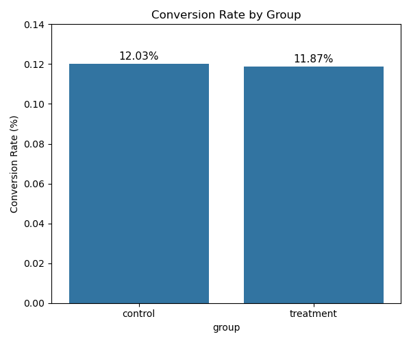
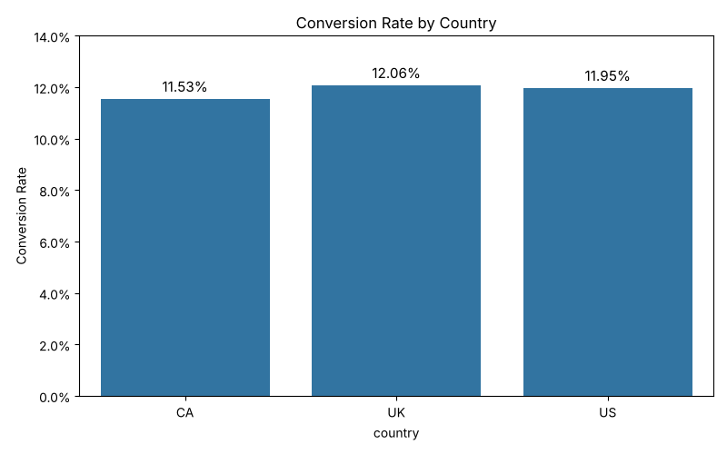

# A/B Testing Analysis: Landing Page Experiment
### Project Overview

This project analyzes an A/B testing experiment conducted by an e-commerce company to evaluate whether a newly designed landing page improves user conversion rates. Users were randomly assigned to either the control group (old landing page) or the treatment group (new landing page). The analysis focuses on determining whether the new page leads to a statistically significant increase in conversions.

### Business Problem

Companies frequently run A/B tests before launching product changes to all users. In this case, the company introduced a new landing page design and wanted to understand whether the change would improve conversions.

The main question behind this experiment is:
Does the new landing page increase the conversion rate compared to the existing page?

### Dataset

The analysis uses two datasets:

- ab_data.csv – Contains experiment data for each user, including group assignment, landing page shown, and whether the user converted.

- countries.csv – Contains information about the country where each user is located.

Together, these datasets allow us to analyze experiment performance and explore whether conversion behavior differs across regions.

### Analysis Approach

The project follows a structured data analysis workflow:

- Loading and exploring the experiment dataset

- Cleaning the data and removing duplicate users

- Validating the experiment setup by checking group and landing page assignments

- Calculating conversion rates for control and treatment groups

- Performing hypothesis testing using a two-proportion Z-test

- Analyzing conversion behavior across different countries

- Running a logistic regression model to evaluate the effect of the landing page on conversion probability

### Key Results

The conversion rate for the control group (old landing page) was approximately 12.03%, while the treatment group (new landing page) had a conversion rate of about 11.87%.

A two-proportion Z-test was conducted to determine whether this difference is statistically significant.

- Z-score: -1.29

- P-value: 0.1956

Since the p-value is greater than the significance level of 0.05, the difference between the two landing pages is not statistically significant.

Country-level analysis also showed similar conversion behavior across the United States, United Kingdom, and Canada.

Logistic regression results further confirmed that the landing page variable is not a statistically significant predictor of conversion.

### Visualizations
Conversion Rate by Group




Conversion Rate by Country




### Conclusion

Based on the analysis, there is no strong statistical evidence that the new landing page improves conversion rates. Although the old page shows a slightly higher conversion rate, the difference is small and not statistically significant.

The results suggest that the company should continue using the existing landing page or consider testing alternative design changes in future experiments.

### Tools Used

- Python
- Pandas
- NumPy
- Matplotlib
- Seaborn
- Statsmodels
- Jupyter Notebook

### Project Structure

```
ab-test-landing-page-analysis
│
├── data
│   ├── ab_data.csv
│   └── countries.csv
│
├── notebooks
│   └── ab_test_analysis.ipynb
│
├── visuals
│   ├── conversion_rate_by_group.png
│   └── conversion_rate_by_country.png
│
└── README.md
```

---

